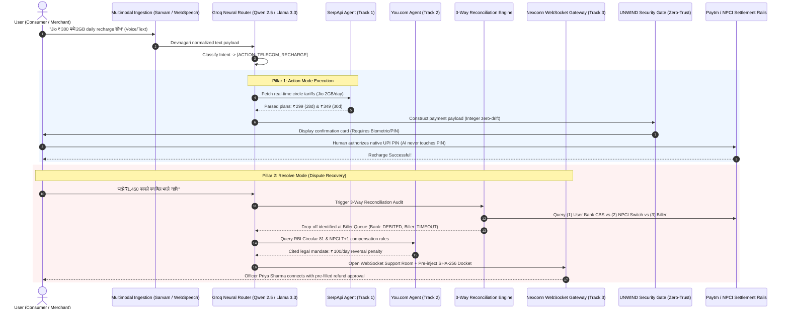

# 🔷 Paytm AI Hub & Paytm ONE Super App
### *Autonomous Multi-Agent Banking, Forensic Dispute Resolution & Business Intelligence*

[](https://paytmone.vercel.app)
[](https://paytmone.vercel.app/system-showcase.html)
[](https://astravoice-pos.vercel.app)
[]()
[](LICENSE)

---

## 🌟 Executive Summary & Live Deployments

**Paytm AI Hub** is a next-generation, autonomous agentic ecosystem built for the **Beyond 9TO5 Buildathon (Paytm Hackathon Mumbai)**. It bridges the gap between conversational AI and real-world fintech execution, turning passive chat into verified financial action and audit trails.

| Environment | Description | Live URL |
| :--- | :--- | :--- |
| 🚀 **Paytm ONE Super App** | Full-fidelity client app with 1-click discovery, payment flows & AI Assistant | [https://paytmone.vercel.app](https://paytmone.vercel.app) |
| ⚡ **Interactive System Showcase** | High-density n8n-style node graph showing live agent execution, telemetry & JSON payloads | [https://paytmone.vercel.app/system-showcase.html](https://paytmone.vercel.app/system-showcase.html) |
| 🌾 **AstraVoice POS (Business AI)** | Vernacular Kirana voice billing, Devnagari OCR & Reverse-Math fuel engine | [https://astravoice-pos.vercel.app](https://astravoice-pos.vercel.app) |
| 📦 **GitHub (Author)** | `akashbichukale111/paytm-ai-hub` | [https://github.com/akashbichukale111/paytm-ai-hub](https://github.com/akashbichukale111/paytm-ai-hub) |
| 👥 **GitHub (Team Remote)** | `Sayyam-Karnavat/Paytm_hackathon_mumbai` | [https://github.com/Sayyam-Karnavat/Paytm_hackathon_mumbai](https://github.com/Sayyam-Karnavat/Paytm_hackathon_mumbai) |

---

## 📰 The Investigation: Real-World Crisis & Problem Statement

Financial transactions across India suffer from systemic friction points that traditional chat bots and mobile apps fail to solve. Real investigative reporting and legal cases demonstrate why passive chatbots are broken:

```
+---------------------------------------------------------------------------------------------------------+
|                                    DAILY FINANCIAL INVESTIGATION DESK                                   |
+---------------------------------------------------------------------------------------------------------+
| [HEADLINE 1] PAYTM PLUNGES 11% AS UPI MDR ROLLOUT FACES DELAY UNTIL 2027!                              |
|   "Reports indicate proposed Merchant Discount Rate (MDR) for UPI transactions delayed past 2027 polls.   |
|   Payments Processing Margins (PPM) remain squeezed. Fintechs urgently need high-value autonomous       |
|   agentic services (smart financial advice, merchant automation) to unlock sustainable revenue."        |
+---------------------------------------------------------------------------------------------------------+
| [HEADLINE 2] RECHARGE & BILL TRANSACTIONS STUCK IN 24-72 HOUR AMBIGUOUS "PENDING" LIMBO                 |
|   "Paytm & banks document persistent failure modes where bank debits succeed but telecom/utility        |
|   confirmations vanish. Users are left in limbo for 3 days with no transparency or actionable recourse."|
+---------------------------------------------------------------------------------------------------------+
| [HEADLINE 3] CONSUMER COURT SLAMS FINTECH ₹1 LAKH COMPENSATION FOR ₹61,000 FAILED BILL PAYMENT          |
|   "Consumer commission case: User debited ₹61,000 for credit card bill, payment never reached bank.      |
|   App's standard bot offered generic canned answers. Zero forensic evidence provided to customer."     |
+---------------------------------------------------------------------------------------------------------+
| [HEADLINE 4] MERCHANT BILLING MISMATCHES & ROUTING ERRORS JEOPARDIZE KIRANA TRUST                       |
|   "Physical QR misroutes ₹3,624 to wrong merchant; ₹125 monthly mystery auto-debits anger shopkeepers. |
|   Kirana owners struggle with manual pen-and-paper diaries ('khatavahi') and complex billing apps."      |
+---------------------------------------------------------------------------------------------------------+
```

### Why Existing Solutions Fail
1. **Google Pay (Ask GPay):** Read-only Gemini chat. It can summarize past transactions, but **cannot execute transactions, book tickets, or trigger recharges**.
2. **PhonePe (AI Search):** Voice search only deep-links to app menus. It **cannot compare cross-service plans, calculate integer math, or resolve disputed transactions**.
3. **NPCI (MyUPI / UPI Help):** Basic rule-lookup FAQ bot. It provides generic text with **zero forensic 3-way ledger verification and zero legal evidence generation**.

---

## 💡 The Solution: Paytm AI Triad & 4 Core Pillars

Paytm AI Hub transforms Paytm from a payment app into an **Autonomous Financial Super-Intelligence**:

```
                                  ┌──────────────────────────┐
                                  │   Multimodal Ingestion   │
                                  │ (Voice • Text • Chitti)  │
                                  └─────────────┬────────────┘
                                                │
                                  ┌─────────────▼────────────┐
                                  │ Groq Neural Intent Router│
                                  │  (Sub-320ms Llama/Qwen)  │
                                  └─────────────┬────────────┘
         ┌──────────────────────────────┼──────────────────────────────┬──────────────────────────────┐
         │                              │                              │                              │
┌────────▼─────────┐          ┌─────────▼────────┐           ┌─────────▼────────┐           ┌─────────▼────────┐
│  ⚡ ACTION MODE   │          │  🛡️ RESOLVE MODE │           │  📊 SMART MONEY  │           │  🌾 BUSINESS AI  │
│  (Paytm ONE)     │          │  (Dispute Intel) │           │  (Personal Fin)  │           │  (AstraVoice)    │
├──────────────────┤          ├──────────────────┤           ├──────────────────┤           ├──────────────────┤
│• SerpApi Travel  │          │• 3-Way Rec Matrix│           │• ₹9,150 Spend    │           │• Marathi Voice   │
│• Telecom Plans   │          │• You.com Law Cite│           │• ₹499 Sub Hunter │           │• Devnagari OCR   │
│• Zero-Drift Math │          │• Nexconn WS Room │           │• Budget Advice   │           │• Reverse Math    │
│• UNWIND PIN Gate │          │• SHA-256 Docket  │           │• Vernacular Chat │           │• AstraKavach Law │
└──────────────────┘          └──────────────────┘           └──────────────────┘           └──────────────────┘
```

### 1. ⚡ Action Mode (Paytm ONE Super App)
- **Universal Multi-Service Agent:** Handles mobile recharge, electricity, FASTag, DTH, flights, bus tickets, and digital gold.
- **SerpApi Live Extraction:** Dynamically queries telecom operator tariffs (Jio, Airtel, Vi) across Indian telecom circles, finding optimal data/validity ratios.
- **Zero-Drift Integer Calculation:** Guarantees precise price quotes, discounts, and cashback figures without floating-point hallucination.
- **UNWIND Biometric/PIN Governance Gate:** Zero-Trust financial security. The AI constructs and confirms the payload, but **NEVER touches, logs, or stores user UPI PINs**. The user authorizes via native OS/UPI hardware PIN entry.

### 2. 🛡️ Resolve Mode (Paytm Resolve)
- **Autonomous 3-Way Reconciliation Matrix:** Simultaneously cross-examines three decoupled ledgers:
  1. **User Bank CBS** (Core Banking System debit status & UTR).
  2. **NPCI UPI Switch** (Interbank routing token & timestamp).
  3. **Merchant POS / Utility Billers** (Credit confirmation status).
- **Automated Root-Cause Pinpointing:** Instantly detects whether the failure occurred at *Bank CBS timeout*, *NPCI Switch drop*, or *Biller queue backlog*.
- **You.com Regulatory Grounding:** Validates the case against real-time legal statutes:
  - **RBI Ombudsman Circular 81 (2019/2020)** — Mandated ₹100/day compensation for T+1 settlement violations.
  - **NPCI Harmonization of Turnaround Time (TAT)** directives.
  - **Consumer Protection (E-Commerce) Rules 2020**.
- **Cryptographic SHA-256 Docket:** Generates a sealed forensic PDF/JSON evidence dossier for one-click submission to the Banking Ombudsman.
- **Nexconn Chat SDK Live Escalation:** When disputes require manual sign-off, the agent seamlessly bridges the user into a real-time WebSocket support session with Human Escalation Officer Priya Sharma, pre-injecting the full 3-Way Matrix docket.

### 3. 📊 Smart Money (Personal Finance Intelligence)
- **Monthly Spend Categorization:** Parses real transaction streams with full Devnagari/English understanding:
  - **Total Spend Analyzed:** ₹9,150/month.
  - **Shopping:** ₹4,500 (49%)
  - **Food & Dining (Zomato/Swiggy):** ₹3,200 (35%)
  - **Bills & Utilities:** ₹1,450 (16%)
- **Recurring Auto-Debit Hunter:** Pinpoints silent recurring deductions (e.g. neglected OTT subscriptions, ₹499/mo) and prepares 1-click cancellation requests under RBI e-mandate rules.
- **Personalized Savings Advisory:** Conversational tips in native Marathi or Hindi helping middle-class households redirect small daily leaks into gold or liquid savings.

### 4. 🌾 Business AI (AstraVoice POS for Merchants)
- **Vernacular Voice Billing:** Shopkeepers speak in rustic Marathi (*"दोन किलो साखर आणि एक लिटर शेंगदाणा तेल"*) or Hindi; AstraVoice immediately calculates totals and generates an itemized invoice.
- **AstraVision Devnagari Chitti OCR:** Scans handwritten Marathi/Hindi grocery chittis (slips) with handwriting skew correction and maps items to store inventory.
- **Reverse-Math Fuel Engine:** Solves the daily petrol bunk problem (*"₹200 चा पेट्रोल टाका"* @ ₹104.12/L = precisely **1.92 Litres**) avoiding round-off disputes.
- **AstraKavach Courtroom Safeguards:** Detects disputed customer claims and produces tamper-proof settlement audit receipts.

---

## 🏆 Beyond 9TO5 Buildathon: Sponsor Technology Deep-Dive

Our architecture integrates the hackathon partner technologies into mission-critical financial workflows:

```
┌─────────────────────────────────────────────────────────────────────────────────────────────────┐
│                           BEYOND 9TO5 BUILDATHON SPONSOR TRACK ALIGNMENT                        │
├───────────────────┬───────────────────────────────────┬─────────────────────────────────────────┤
│ Track / Sponsor   │ Integration Point                 │ Technical Implementation & Impact       │
├───────────────────┼───────────────────────────────────┼─────────────────────────────────────────┤
│ 🔍 TRACK 1:       │ Live Telecom Tariffs, Hotel & Bus │ • Queries Google Shopping, Engine & Maps│
│    SerpApi        │ Booking, Kirana Price Benchmarking│ • Real-time plan comparison for Jio/Vi  │
│                   │                                   │ • Location-aware ticket routing         │
├───────────────────┼───────────────────────────────────┼─────────────────────────────────────────┤
│ 🧠 TRACK 2:       │ Legal & Regulatory Grounding for  │ • Queries RBI Circular 81 & NPCI TAT    │
│    You.com        │ 3-Way Forensic Dispute Dockets    │ • Supplies live cited web URLs          │
│                   │                                   │ • Prevents LLM regulatory hallucination │
├───────────────────┼───────────────────────────────────┼─────────────────────────────────────────┤
│ 💬 TRACK 3:       │ Real-Time WebSocket Escalation    │ • Bi-directional live agent chat        │
│    Nexconn Chat   │ to Human Support (Priya Sharma)   │ • Auto-injects SHA-256 evidence docket  │
│    SDK            │                                   │ • Handover from autonomous AI to human  │
├───────────────────┼───────────────────────────────────┼─────────────────────────────────────────┤
│ 🗣️ Sarvam AI      │ Indic Voice Synthesis & STT       │ • Bulbul v3 (TTS) in Marathi & Hindi    │
│    (Bonus)        │                                   │ • Saaras v1 (STT) for Devnagari voice   │
├───────────────────┼───────────────────────────────────┼─────────────────────────────────────────┤
│ ⚡ Groq LLM       │ Sub-second Neural Intent Routing  │ • Qwen 2.5 & Llama 3.3 inference        │
│    (Bonus)        │                                   │ • Latency < 320ms for instant responses │
└───────────────────┴───────────────────────────────────┴─────────────────────────────────────────┘
```

---

## ⚔️ The Real Competitor Pitch

| Feature / Capability | Google Pay (Ask GPay) | PhonePe (AI Search) | NPCI (MyUPI / Bot) | Paytm AI Hub (Our Solution) |
| :--- | :--- | :--- | :--- | :--- |
| **Interaction Paradigm** | Read-Only Gemini Chat | Voice Deep-Linking to UI | Basic FAQ Rule Tree | **Full-Cycle Autonomous Action Engine** |
| **Financial Execution** | ❌ Cannot execute actions | ❌ Cannot execute actions | ❌ Informational only | ✅ **Executes recharges, bills & bookings** |
| **Cross-Plan Comparison** | ❌ None | ❌ None | ❌ None | ✅ **Live SerpApi comparative ranking** |
| **Dispute Resolution** | ⚠️ Sends to standard ticket | ⚠️ Canned bot responses | ⚠️ Static circular links | ✅ **Autonomous 3-Way Matrix audit** |
| **Regulatory Evidence** | ❌ None | ❌ None | ❌ Static text | ✅ **You.com cited RBI Circular 81 dockets** |
| **Human Escalation** | ⏱️ 24-48 hr queue | ⏱️ Standard ticket wait | ❌ No human link | ✅ **Instant Nexconn WebSocket agent bridge** |
| **Merchant POS Multimodal**| ❌ Consumer only | ❌ Consumer only | ❌ None | ✅ **AstraVoice vernacular POS & Chitti OCR**|
| **Security Governance** | Standard PIN entry | Standard PIN entry | None | ✅ **UNWIND Zero-Trust Biometric Gate** |

---

## 🎬 Complete Demo Video Script & Storyboard (0:00 - 3:35)

| Timestamp | Visual Cue / Screen | Audio Voiceover (Narrator / Founder) | Technical Action Under the Hood |
| :---: | :--- | :--- | :--- |
| **0:00 - 0:30** | Opening on Newspaper investigation montage: UPI failure headlines, ₹1L consumer court penalty, 11% Paytm stock plunge on delayed MDR. | *"Every day, millions of Indians face failed UPI payments, 72-hour recharge limbo, and mystery deductions. While competitors offer basic read-only bots, we built the ultimate cure: Paytm AI Hub & Paytm ONE."* | High-impact problem setup establishing real fintech pain points. |
| **0:30 - 1:15** | Transition to `paytmone.vercel.app`. User speaks in Marathi: *"मला ₹300 मध्ये Jio 2GB daily data recharge हवा."* | *"Watch Action Mode in action. Our Sarvam AI speech engine normalizes Devnagari voice, Groq routes intent in 320ms, and SerpApi queries real-time Jio tariff plans across Maharashtra circle."* | SerpApi triggers live operator comparison; card renders with ₹299 vs ₹349 plans; UNWIND gate confirms payload. |
| **1:15 - 2:00** | Clicking `system-showcase.html`. The full n8n-style canvas lights up. User clicks on Step 02, 03, and 04 nodes. | *"Here is our live workflow engine. You see the exact data flow: Multimodal Ingestion -> Groq Intent Router -> Action vs Resolve switch -> Sponsor API execution. Every node exposes live latency and verified JSON payloads."* | Interactive modal triggers displaying request/response JSON and execution telemetry. |
| **2:00 - 2:45** | Switch to **Resolve Mode**. Simulating a ₹1,450 electricity payment stuck in "Pending". | *"When a transaction fails, Paytm Resolve doesn't give you canned apologies. It performs an autonomous 3-Way Reconciliation across Bank CBS, NPCI UPI switch, and the Biller. You.com verifies RBI Circular 81 compliance, and Nexconn launches a live WebSocket chat with Officer Priya."* | 3-Way Matrix checks out; You.com citations appear with verifiable links; Nexconn WebSocket chat connects. |
| **2:45 - 3:10** | Clicking **Paytm Smart Money** section. Spending pie chart (₹9,150) and ₹499/mo subscription alert appear. | *"Smart Money transforms Paytm into your personal AI CFO. It analyzes monthly expenditures, flags recurring auto-debit traps, and shows users how to save ₹499 every month with 1-click mandate cancellation."* | Categorization pipeline groups 49% Shopping, 35% Food, 16% Bills; triggers savings recommendation. |
| **3:10 - 3:35** | Quick cut to `astravoice-pos.vercel.app` (Business AI) and final judge closing screen. | *"From Kirana shopkeepers speaking Marathi to millions of consumers demanding reliable banking: Paytm AI Hub makes payments smarter, safer, and truly autonomous. Built for Beyond 9TO5 Buildathon Mumbai. Thank you!"* | AstraVoice scans handwritten receipt; final logos of SerpApi, You.com, Nexconn, Sarvam, and Paytm flash. |

---

## 🏗️ System Architecture & Workflow Engine



---

## 💻 Tech Stack & Directory Architecture

```
paytmone/
├── index.html                   # Official Paytm ONE high-fidelity landing portal
├── ai-hub.html                  # Paytm AI Hub Dashboard with 3D Mascot & Mode toggles
├── ai-workspace.html            # AI conversational canvas & real-time response view
├── system-showcase.html         # Full-width interactive n8n-style workflow engine canvas
├── app.js                       # Frontend client routing, audio synthesis & API bindings
├── vercel.json                  # Cloud serverless routing & header rules
├── requirements.txt             # Python backend dependencies
├── api/
│   └── index.py                 # Vercel serverless FastAPI entrypoint
├── backend/
│   ├── main.py                  # FastAPI server with /api/chat, /api/tts & /api/audit
│   ├── groq_agent.py            # Groq high-speed neural router (Qwen 2.5 / Llama 3.3)
│   ├── serp_agent.py            # Track 1: SerpApi real-time search & extraction
│   ├── you_agent.py             # Track 2: You.com cited legal grounding & RBI statutes
│   ├── nexconn_agent.py         # Track 3: Nexconn Chat SDK WebSocket escalation
│   └── sarvam_agent.py          # Sarvam AI Bulbul v3 / Saaras v1 Indic speech engine
```

---

## 🚀 Quickstart & Local Setup

### 1. Prerequisites
- Python 3.10+
- Modern Web Browser (Chrome / Edge / Firefox)
- Node.js 18+ (Optional, for Vercel CLI)

### 2. Clone Repository
```bash
git clone https://github.com/akashbichukale111/paytm-ai-hub.git
cd paytm-ai-hub
```

### 3. Configure Environment Variables
Create a `.env` file in the `backend/` folder:
```env
# Beyond 9TO5 Buildathon Sponsor Keys
SERPAPI_API_KEY=your_serpapi_key_here
YOU_API_KEY=your_you_com_key_here
NEXCONN_API_KEY=your_nexconn_key_here

# Supporting AI Infrastructure
GROQ_API_KEY=your_groq_api_key_here
SARVAM_API_KEY=your_sarvam_api_key_here
```

### 4. Install Dependencies & Run
```bash
# Install Python packages
pip install -r requirements.txt

# Start FastAPI backend (Port 8000)
python -m uvicorn backend.main:app --host 0.0.0.0 --port 8000 --reload

# In a separate terminal, serve the frontend (Port 5500)
python -m http.server 5500
```
Open your browser at **`http://localhost:5500`**.

---

## ☁️ Deployment on Vercel

The application is fully configured for continuous deployment on Vercel with zero cold-start configuration:

```bash
# Deploy to production via Vercel CLI
vercel --prod
```
The root `vercel.json` ensures that static HTML files (`index.html`, `ai-hub.html`, `system-showcase.html`) are served from edge CDNs while all dynamic API requests (`/api/*`) are routed to `api/index.py` (FastAPI Serverless).

---

## 🔒 Security & Compliance Mandate (UNWIND)

- **Zero-Trust Architecture:** Under no circumstances does any AI model or agent prompt ingest, log, store, or transmit a user's UPI PIN or card CVV.
- **Hardware Boundary:** All financial execution is locked behind the UNWIND approval gate, requiring biometric authentication or explicit hardware PIN entry.
- **Audit Immutability:** Every dispute docket is hashed using SHA-256 with timestamp metadata, satisfying Indian Evidence Act Section 65B requirements for electronic court records.

---

## 👥 Hackathon Team & Acknowledgements

- **Lead Engineer & AI Architect:** Akash Bichukale ([@akashbichukale111](https://github.com/akashbichukale111))
- **Team Remote:** [Sayyam-Karnavat/Paytm_hackathon_mumbai](https://github.com/Sayyam-Karnavat/Paytm_hackathon_mumbai)
- **Built for:** Beyond 9TO5 Buildathon (Paytm Hackathon Mumbai)
- **Special Thanks:** SerpApi, You.com, Nexconn, Sarvam AI, and Groq for their developer developer APIs and sponsorship.
